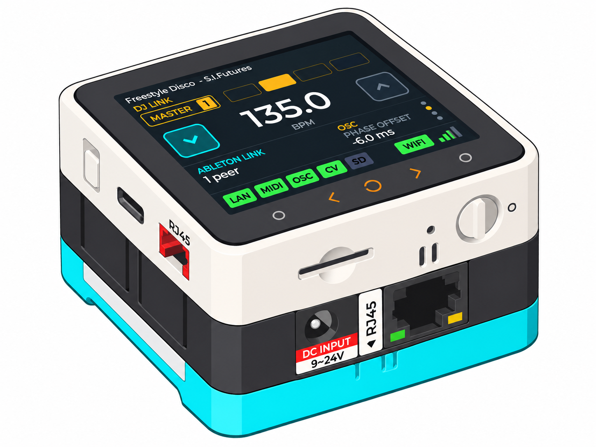
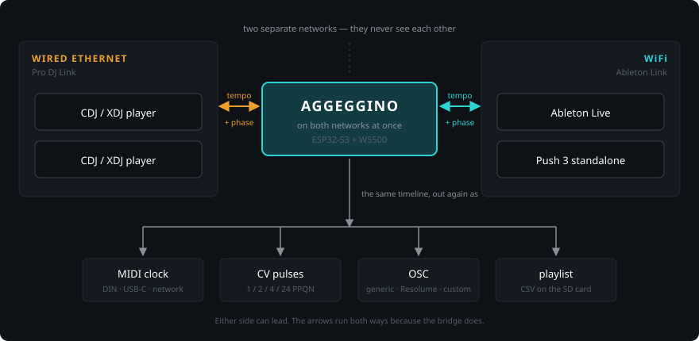
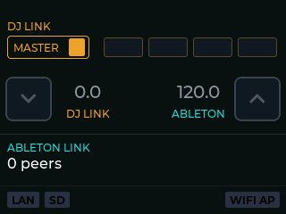
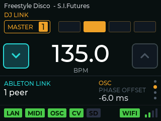

# AGGEGGINO

/addʒedˈdʒino/ · *n.* [It., dim. of **aggeggio**: gizmo]
A small device persuading two machines to share a downbeat.



---

**Bidirectional bridge between Pioneer Pro DJ Link and Ableton Link, running on
an ESP32-S3 (M5Stack CoreS3-SE). Acts as a real tempo master on both sides, and
puts the same timeline out again as MIDI clock — over USB-C, over DIN or over
the network — as analog CV pulses and as OSC.**

---

## What it does



AGGEGGINO lets Pioneer CDJ/XDJ players and Ableton Link software share a single
timeline, in both directions. It joins the DJ Link network over wired Ethernet
and the Ableton Link session over WiFi — the two protocols normally live on
separate networks — and can either follow the current master or become one
itself.

Tempo and phase are also available as MIDI clock — three transports, all of
them live at once if you want: class-compliant USB-MIDI on the USB-C port, MIDI
DIN through an optional module, and Network MIDI 2.0 over UDP — as analog CV
pulses, and as OSC. So the same timeline can drive hardware sequencers, visuals
and lighting, each with its own phase offset.

Most existing work in this area reads the DJ Link network and stops there.
Transmitting, and being *accepted* as tempo master by real players, is a
considerably stricter requirement: it forces you to measure things you can
otherwise get away with guessing.

<table>
<tr>
<td width="50%"></td>
<td width="50%"></td>
</tr>
<tr>
<td><b>No bridge.</b> The players at 128.5, the Link session at 122.0. Two
clocks, not talking.</td>
<td><b>Bridging.</b> One tempo, one phase, and the outputs that carry it —
here MIDI, OSC and CV at once, with a −6 ms offset on the OSC.</td>
</tr>
</table>

Screenshots taken by the device itself: it writes its own screen to the SD
card, which is how the pictures in [the manual](docs/) are made.

## An appliance, not a computer

The usual way to do this is software on a laptop, and a good part of the point
of AGGEGGINO is that it is not.

- **Instant on, instant off.** Nothing boots. No operating system to come up,
  no application to launch, no audio or MIDI device to pick out of a list, no
  update waiting for you the evening of a gig. Switch it on and it is bridging;
  switch it off when you are done.
- **It remembers.** Networks and keys, bridge direction, which outputs are on
  and how they are set, the phase offsets — all in flash, all restored at
  power-up. Configure it once at the bench and it arrives configured.
- **It takes a corner of the table**, and a pocket of the bag, instead of a
  laptop and its charger.
- **Nothing else runs on it.** There is no second process to take the CPU at
  the wrong moment, which is what makes the timing in the protocol notes the
  timing it also has in a booth.

It is, admittedly, also fairly geeky. In a DJ booth that has never been a
disadvantage.

## Status

Working and tested on hardware against 2× Pioneer XDJ-700, Ableton Live and
Push 3 standalone. This is a personal project, not a product — expect the
unexpected!

The firmware sources still use `djbridge` as an internal name throughout
components, log tags and build files. It is the same thing.

## Hardware

**Three M5Stack modules, stacked** — which is what the picture above shows,
from the top down:

| module | SKU | what it brings |
|---|---|---|
| **CoreS3-SE IoT Controller** | `M5-K128-SE` | the ESP32-S3 itself: touch display, PSRAM, I²S audio, USB-C |
| **LAN Module 13.2** (W5500) | `M5-M136` | wired Ethernet for the DJ Link side: RJ45, and the DC jack that powers the stack |
| **M5GO Battery Bottom3** | `M5-A014-D` | the 500 mAh battery, and the ten WS2812 LEDs, five down each side |

The Bottom3 is the **CoreS3-only** variant — the other M5GO bottoms do not fit
this Core.

WiFi for the Ableton Link side is built into the Core; nothing is added for it.

The two protocols genuinely live on separate networks — the players on the
wire, Link over the air — so the wired module is not an optional extra, it is
half of what the bridge is.

**Optional, for MIDI DIN:** an **M5Stack Unit MIDI with DIN connector**
(SAM2695), SKU `M5-U187`, on Port C with a **Grove cable**. It also provides
the audible click. Everything else — USB-MIDI, network MIDI, CV, OSC — works
without it.

**Power it from the LAN module's DC jack**, not from USB-C: 9–24 V into a
DC5521 barrel (5.5 × 2.1 mm, centre positive), which the module steps down for
the whole stack. The battery in the Bottom3 is a 500 mAh buffer — it is there
so that a kicked plug or a flickering mains does not take the bridge down in
the middle of a set, and it is not sized to run the device for one.

Built with ESP-IDF 5.5.4 and LVGL 9. [**docs/building.md**](docs/building.md)
has the toolchain and the build.

## Features

The whole of it, in one place:

| | |
|---|---|
| **DJ Link** | over wired Ethernet. Virtual CDJ holding a real device number **1–4**, or `OBSERVER` to watch without claiming one. Reads beat and status, and transmits both; can take the tempo master role. Track metadata over `dbserver` |
| **Ableton Link** | over WiFi, either as **SoftAP** — the device makes the network and your laptop or Push joins it — or as a **client** of a network you already have. Full peer, and able to join a session without imposing its own tempo |
| **Bridging** | **both directions**, one at a time: DJ Link → Ableton, or Ableton → DJ Link |
| **MIDI clock** | **three transports**, each switchable on its own and all usable at once: **USB-C** class compliant, **MIDI DIN** on the optional module, and **Network MIDI 2.0** over UDP, announced over mDNS |
| **CV** | pulses on Port B pin 1. Division `1` / `2` / `4` / `24` PPQN, five pulse widths from `1` to `20` ms clamped to 45% of the beat, polarity either way up |
| **OSC** | UDP to a host and port of your choosing, as `GENERIC`, `RESOLUME`, or a **`CUSTOM` profile of up to eight messages** built on the device — each with its own trigger, and placeholders for tempo, bar, title, artist, track id and player |
| **Phase offset** | **±500 ms**, advance *or* delay, in 0.5 ms steps — and set **independently for every destination**: the bridge's far end, OSC, MIDI and CV each carry their own |
| **SD card** | the set written as CSV while it plays, one line per track held past a threshold of 15–180 s. Screenshots too, in development builds |
| **Reading it across a room** | ten side LEDs, five down each side — the left strip the DJ Link side, the right the Ableton side — a status badge per subsystem, and a screen lock for a booth |
| **Settings** | kept in flash and restored on power-up, with a factory reset |

In detail:

**Pioneer Pro DJ Link**

- Virtual CDJ: keep-alive, presence, device number claim (1–4) with a staged
  negotiation, and master takeover through the status channel
- reads beat packets and player status; transmits both when acting as master
- follows a tempo change as quickly as a real player does: when you move the
  pitch, everything downstream moves with it instead of catching up
- track metadata (title, artist, tempo) over the `dbserver` protocol
- answers ONC-RPC portmapper queries: you will not see any `E-8309 Link Access
  Error` on the player's display

**Ableton Link**

- full peer participation through Ableton's official `abl_link` library
- can join a session without imposing its own tempo

**Clock outputs**

- **MIDI clock over three transports**, independent of each other:
  - **USB-C**, class compliant — the host sees a MIDI device, no driver
  - **MIDI DIN**, through an optional M5Stack Unit MIDI on Port C
  - **Network MIDI 2.0** (UMP over UDP), announced over mDNS as `_midi2._udp`
- **analog CV pulses**, configurable division (1/2/4/24 PPQN), width and
  polarity, with the width clamped to 45% of the period so a pulse can never
  swallow its own beat
- **OSC**, with a generic and a Resolume preset, plus a **custom profile** built
  on the device: up to eight messages, each with its own trigger, and
  placeholders for tempo, bar, title, artist, track id and player
- **a phase offset per destination**, ±500 ms in 0.5 ms steps, because a video
  wall and a modular clock do not want the same correction

**On the SD card**

- the set written as it happens: a CSV line per track played past a
  configurable threshold, with time, player, track id, title, artist and tempo
- a silence longer than that threshold closes the file and the next track opens
  a new one

**Timing**

This is where most of the work went, and it is the part you cannot see when it
is working.

- **it holds through a whole set, not just the first ten minutes.** Our clock
  and the players' are never quite the same, and the difference moves while
  the device warms up. It is measured continuously and corrected as it runs,
  so the two sides do not creep apart over the evening
- **the beat leaves when it is due**, whatever the screen and the two networks
  are doing at that moment — the downbeat does not wander because something
  else was busy
- the measurements behind both, and the comparison against what a real CDJ
  manages, are in the [protocol notes](docs/protocol-notes.md)

## Documentation

The manual lives in [`docs/`](docs/) and is versioned with the firmware it
describes — a `git checkout` of a tag gives you both, matching.

- [**Getting started**](docs/getting-started.md) — what you need, the two
  networks, and the first bridge from scratch
- [**The dashboard**](docs/dashboard.md) — the main screen, the three buttons
  under the glass, the screen lock
- [**Settings**](docs/settings.md) — the complete menu tree
- [**Clock outputs**](docs/outputs.md) — MIDI, CV, OSC, and the custom OSC
  profile
- [**The SD card**](docs/sd-card.md) — playlists as CSV, formatting, screenshots
- [**When something is wrong**](docs/troubleshooting.md) — by symptom

## Protocol documentation

The DJ Link implementation is a clean-room effort based on direct observation of
real hardware. The notes are in this repository, in
[English](docs/protocol-notes.md) and in the
[Italian](docs/protocol-notes.it.md) they were measured and written in.

Every non-obvious claim in them is marked with its evidence:
**[M]** measured on real hardware, **[D]** deduced from measurements with the
reasoning spelled out, **[I]** an unverified hypothesis, **[E]** from an external
source. There is also a section listing what is still unknown.

A declared uncertainty is worth more than an invented certainty: a guess marked
as a guess can be tested, while a guess stated as fact gets built on.

## Building

ESP-IDF 5.5.4.

```
idf.py set-target esp32s3
idf.py build
idf.py -p <PORT> flash monitor
```

[**docs/building.md**](docs/building.md) has the rest, and three things in it
are worth knowing before you start:

- **`DJB_DEVELOPER`** in the top-level `CMakeLists.txt` is **0** here, the
  production build. At 1 it adds the Developer page, screenshots to the card
  and the CPU / SPI / beat-jitter metrics — and the FreeRTOS instrumentation
  that feeds them, which costs work at every context switch. Timing measured
  with it on is not the timing of the firmware people run.
- **After changing that switch, `sdkconfig` has to be deleted.** It is
  generated once from the `.defaults` files and then kept, so otherwise the
  build quietly keeps the old configuration and the switch looks inert.
  `idf.py fullclean` does **not** do this — it empties the build directory and
  leaves the project configuration alone.
- **The serial console is on Port B, not USB-C** (USB-C belongs to TinyUSB for
  MIDI). Connect only GND and TX: the console's RX pin is also the CV output,
  so an adapter's TX wired to it puts two outputs on one line.

Managed dependencies (LVGL, `esp_abl_link`, the ILI9341 driver, TinyUSB, mDNS)
come down by themselves from the `idf_component.yml` manifests. WIZnet's
ioLibrary is committed rather than fetched, and
[`components/w5500_net/VENDORED.md`](components/w5500_net/VENDORED.md) explains
why: this code works around a defect in the library's own `recv()`, so the
revision matters.

## The name

*Aggeggio* is Italian for a contraption, a gizmo — a thing that clearly does
something, though not always something you can name. *Aggeggino* is its
diminutive, and carries the affection that comes with it.

## Coffee

*Code for the studio, coffee for the bench.*

[](https://buymeacoffee.com/alekappa)

## License

**GPL-3.0-or-later.** See [LICENSE](LICENSE).

This is not a free choice: AGGEGGINO links against Ableton Link, which is
[dual licensed](https://github.com/Ableton/link/blob/master/LICENSE.md) under
GPLv2-or-later and a separate proprietary license. Distributing a combined work
that includes it therefore requires a GPL-compatible license. GPLv3 is used
rather than GPLv2 because ESP-IDF is Apache-2.0, which is compatible with GPLv3
but not with GPLv2.

If you want to build something proprietary on top of this, the Ableton Link
license is the thing to sort out first — contact `link-devs@ableton.com`.

## Acknowledgements

- **Ableton** for Link and for publishing it as open source.
- **Deep Symmetry** (`beat-link`, `dysentery`) for years of public work on the
  DJ Link protocol. Their implementations were used for orientation only, never
  copied — and in at least one case this project deliberately diverges from
  their choices, for reasons documented in the protocol notes.

## Trademarks

Pioneer DJ, CDJ and XDJ are trademarks of AlphaTheta Corporation. Ableton and
Ableton Link are trademarks of Ableton AG. This project is not affiliated with,
endorsed by or supported by either company.
