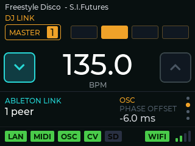
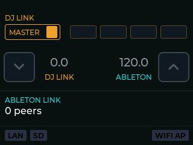

# The dashboard

[← documentation index](README.md)

The screen you get at power-on. Everything on it is readable at arm's length in
a dark booth, which is the only design constraint that mattered.



## The track line

The topmost line: what the master is playing, read from the player over the
`dbserver` protocol.

It behaves in three ways depending on what fits and what is known:

- **title and artist both fit** → shown together, `Title - Artist`, no movement
- **they do not fit** → they alternate every **3 seconds**
- **only one is known** → always that one, with no pointless flashing

The title is drawn lighter than the artist. That is the only thing telling them
apart: labels would have cost space the line does not have.

**With playback stopped the line is empty**, but the data stays in memory — so
if the same piece resumes there is no fresh query to the player.

The measurement of whether the two fit is done **once per track change**, not
at the 20 Hz the screen refreshes at. Track names are full of accents and
apostrophes, so the width is measured by LVGL on the real font rather than
estimated by counting characters.

An empty line while something is clearly playing usually means the metadata
query could not run — see
[when something is wrong](troubleshooting.md#no-title-or-artist-in-the-playlist-or-in-title-over-osc).

## Top band — DJ Link

**The MASTER badge**, top left, with the device number in a square beside it.
The number is the DJ Link identity actually held, 1–4 when real. The badge's
colour is the state of the master role:

| colour | meaning |
|---|---|
| steady amber | a Pioneer player is the tempo master |
| blinking amber | we are negotiating for the role; it is not ours yet |
| steady green | we are the master |
| blinking red | the negotiation failed. The bridge has stopped |

**Four beat boxes**, to its right, light in turn with the bar: 1, 2, 3, 4. They
follow whichever side currently provides the phase.

## Middle — the tempo

Two mutually exclusive layouts, and which one you see tells you whether a
bridge is running.

**No bridge:** two grey numbers side by side, `DJ LINK` on the left in amber and
`ABLETON` on the right in cyan. Two independent tempos, neither imposed on the
other.



Here the players are at 128.5 and the Link session at 122.0 — they are simply
not talking to each other, and the screen says so by showing both.

**A bridge running:** one large white number with `BPM` under it. The tempo both
sides now share.

### The two toggles

One at each edge, at the height of the large number. They are mutually
exclusive — turning one on turns the other off.

| | |
|---|---|
| **left, cyan, arrow down** | DJ Link → Ableton. The players lead; the Link session follows them. |
| **right, arrow up** | Ableton → DJ Link. Ableton leads; the players follow, driven through their pitch. |

Tap to switch. If a toggle flashes red instead of switching, the screen is
locked — see below.

**Only the right-hand direction needs the master role.** Imposing a tempo on
the players means being their tempo master, and that has to be negotiated.
Following them needs nothing of the sort: we read their tempo and put it into
the Link session, and a Pioneer player stays master throughout — which is why
the MASTER badge above can sit amber with a player's number on it while the
left toggle is lit.

## Lower band — Ableton Link and the phase offset

**Left:** `ABLETON LINK` and the peer count. A peer is any other participant in
the Link session: Live, a Push, another bridge.

**Right: PHASE OFFSET.** A deliberate delay or advance applied to what we send,
adjustable from the two arrows under the glass. It exists because every link in
a chain has its own latency and nothing else can compensate for yours.

- step **0.5 ms**, range **±500 ms**
- held through a power cycle
- a sustained press repeats quickly after about 400 ms

The offset is **per destination**, because a video projector and a modular
clock do not need the same correction:

| destination | what it delays |
|---|---|
| the bridge's far end | DJ Link or Ableton, whichever is receiving |
| OSC | the OSC output only |
| MIDI | the MIDI clock only |
| CV | the CV pulses only |

Only destinations that are actually active appear. With more than one, the
destination's name shows on a line of its own above the caption, a column of
dots appears at the far right with the current one drawn larger, and **tapping
the offset field cycles to the next one**. The tap changes only what you are
looking at, never a value, so a stray touch is harmless.

With no bridge running the field is not shown at all, and the arrows do
nothing — there is no phase to offset.

## Bottom strip — the status badges

A row of badges, left to right. A badge that is **absent** means the thing is
switched off in the settings; a badge that is present carries a colour:

| badge | green | grey | red |
|---|---|---|---|
| **LAN** | the W5500 is there and the cable is in | cable unplugged | the W5500 is not answering |
| **WIFI** / **WIFI AP** | a client joined the AP, or we joined a network | up, but nobody at the other end | the adapter or the SoftAP failed |
| **MIDI** | clock going out | enabled, nothing to send | enabled but failed to start |
| **OSC** | packets going out | enabled, nothing to send | enabled but unusable |
| **CV** | pulses going out | enabled, nothing to send | enabled but unavailable |
| **SD** | mounted, writing the playlist | mounted, playlist off | card present but unusable |

**LAN is always shown.** The others appear only when enabled. The SD badge is
also absent when no card is in the slot.

Two things about this strip are deliberate, and knowing them saves
misreading it.

**The badges do not blink, and the LEDs do.** Blinking was tried here and
removed: a blinking LED is a point of light at the edge of vision, while a
blinking badge is a filled rectangle moving underneath text you are trying to
read. Same rate, very different irritation. Protocol state still reaches the
screen, but where it earns the room — the MASTER badge, the beat boxes, the
tempo.

**The badges tell you about the plumbing, not about the protocol.** Three
colours, and that is all: red faulty, grey inert, green working. A green
**LAN** badge means the chip answered and the cable is in — it says nothing
about whether any Pioneer is out there, which is what the left-hand LED strip
and the MASTER badge are for. Likewise **one** MIDI badge covers all three
transports: the strip answers *is MIDI going out*, not *through which port*.

On the right-hand side:

- **the WiFi badge**, labelled `WIFI` in client mode and `WIFI AP` in SoftAP.
  In client mode a signal-strength glyph sits beside it.
- **a green badge with a number**, in SoftAP mode only: how many clients are
  connected.
- **AUTH**, in red, to the left of the WiFi badge: the network was found but
  refused our key. It means the password, not the signal.

## The three buttons under the glass

Printed on the glass below the screen, not on it. Three zones, with dead bands
between them so that a near miss does nothing rather than the wrong thing:

```
     0 ...... 100 | 125 ... 195 | 220 ...... 319
     left arrow   ^   circle    ^   right arrow
                 dead          dead
```

The dead bands are deliberate. With contiguous zones, one pixel changed the
action — and aiming at the circle to open the settings while landing on an
arrow would move the phase offset, that is, put the clock out of phase in the
middle of a set.

| | |
|---|---|
| **arrows** | adjust the phase offset of the focused destination |
| **circle, short tap** | open the settings |
| **circle, long press (1.5 s)** | lock the screen, and unlock it again |

**With the screen flipped** (`Settings > UI > Screen flip`) the two arrows swap
meaning. The strip is printed on the glass and does not rotate, so the arrow
physically on the left is on your right when the device is turned round — and
its upside-down glyph looks exactly like a right arrow. The circle is
unaffected, being symmetrical.

## The screen lock

A long press on the circle locks the interface, with a distinct tone. A second
long press unlocks it.

While locked, a padlock glyph shows at the top right and **the whole screen
surface** refuses input: a touch anywhere makes the padlock flash red and sounds
an error tone. Not the element you touched — the padlock, every time, wherever
you touched. That consistency is the point: an interface that beeps in one place
and flashes in another leaves you guessing what it heard.

The long press on the circle is the one thing that still works.

> **With screenshots switched on, they borrow this gesture, deliberately.**
> With `DJB_DEVELOPER` on and `Settings > System > Developer > Save
> screenshots` enabled, a long press on the circle writes a BMP to the card
> instead of locking the screen — same zone, same 1.5 s, and the screenshot is
> recognised first.
>
> It is a loan rather than a clash. Screenshots exist to produce the pictures
> in this manual, which is a thing one does at a desk with the device in hand;
> the lock exists for a booth, where nobody is compiling a development build.
> The two are never wanted in the same hour. Production builds have neither the
> Developer menu nor the substitution.

## What the LEDs say

With the LED base fitted, ten LEDs in **two strips of five down the sides** of
the unit — and which side they are on is the whole point:

| | |
|---|---|
| **left-hand strip** | the LAN and DJ Link side |
| **right-hand strip** | the WiFi and Ableton Link side |

That mirrors the dashboard, where DJ Link is on the left and Ableton on the
right, and it means the device is readable **across a room with the screen
unreadable** — which is the state it is usually in, on a shelf behind the
booth. A red strip on the left is a cable; a red strip on the right is a
password.

**Left strip — LAN and DJ Link:**

| | |
|---|---|
| steady red | the W5500 was not detected |
| blinking red | RJ45 cable unplugged |
| blinking blue | link up, no Pioneer player seen |
| steady blue | players on the network, stopped |
| steady green | the master is playing |
| fast-blinking white | identity conflict — see [troubleshooting](troubleshooting.md) |

**Right strip — WiFi and Ableton Link:**

| | |
|---|---|
| steady red | the access point or station failed to start |
| blinking red | the network is there and refusing our key |
| blinking blue | AP up, no client connected |
| steady blue | a client, but no Link peer |
| steady green | at least one peer in the session |

Brightness is set under `Settings > UI > LED brightness`, including **OFF** —
which is what you want on a dark stage.
