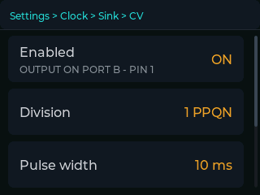

# Clock outputs

[← documentation index](README.md)

`Settings > Clock > Sink`. Three families — MIDI, OSC, CV — all fed from the
same phase source: the bridge's tempo and beat position, wherever they currently
come from. Each has its own phase offset, adjustable from the dashboard.

They are independent. Turning all three on at once is normal.

---

## MIDI

`Settings > Clock > Sink > MIDI`. Three transports, one clock engine. Each has
a single **Enabled** row, because the state of the hardware is a state of that
row rather than a setting of its own: it shows as a subtitle when it matters.

### MIDI USB-C

`Settings > Clock > Sink > MIDI > MIDI USB-C`

Standard USB-MIDI over the CoreS3's USB-C port. The host sees a MIDI device
called **Aggeggino**, with a port named **Aggeggino clock**.

Plug it into a computer and it appears like any class-compliant interface; no
driver, nothing to install. The subtitle under **Enabled** says whether a host
has enumerated us — the row is about what we *want*, the subtitle about what is
actually happening.

> The USB serial console is disabled in this firmware, because it would clash
> with the MIDI class exposed through TinyUSB on the same port. Serial logs come
> out of Port B instead.

### MIDI DIN Plug

`Settings > Clock > Sink > MIDI > MIDI DIN Plug`

Needs an **M5Stack Unit MIDI (U187)** on **Port C**. 31250 baud, as the standard
requires.

When the module is absent the row shows **PORT C: MODULE NOT DETECTED** in red
underneath. The switch still works with the module missing — you are setting
what you *want*, and the transport makes it happen as soon as the hardware is
there. Detection is continuous, so plugging the module in is noticed without a
restart.

### Network MIDI 2.0

`Settings > Clock > Sink > MIDI > Network MIDI 2.0`

Universal MIDI Packets over UDP, following the MIDI Association's *User Datagram
Protocol for Universal MIDI Packets*. The implementation is a third-party
component, documented in
[`components/midi_network/VENDORED.md`](../components/midi_network/VENDORED.md).

| entry | |
|---|---|
| **Enabled** | The host itself. |
| **Announce** | Whether the service is advertised over mDNS as `_midi2._udp`. |

**Announce** deserves a word. With it off the host still runs and still accepts
connections — but nothing will find it, because clients discover the endpoint
through mDNS. Leave it on unless you have a reason; without the announcement
nobody finds us.

Tested against macOS's **MIDI UMP**. Changing either row restarts the host,
which takes a moment.

---

## CV

`Settings > Clock > Sink > CV`

Analogue pulses on a GPIO, for anything with a clock input: a modular
sequencer, a drum machine, a trigger input.

**The output is on Port B, pin 1.** The menu says so under **Enabled**, and in
those words, because the GPIO number has no marking on the connector.

| entry | options | |
|---|---|---|
| **Enabled** | `ON` / `OFF` | |
| **Division** | `1 PPQN` · `2 PPQN` · `4 PPQN` · `24 PPQN` | pulses per quarter note |
| **Pulse width** | `1 ms` · `2 ms` · `5 ms` · `10 ms` · `20 ms` | |
| **Polarity** | `IDLE LOW` / `IDLE HIGH` | |
| **Sound** | a percussion note | needs the DIN module |

**Division comes first in the list** because getting it wrong is the one mistake
with a loud result: at the wrong division everything plays at double speed, or
at a twenty-fourth of it. The rest are refinements. `1 PPQN` is the eurorack
convention and the default.

**Pulse width** is a fixed set rather than a free number, because inputs
disagree: some want at least 1 ms, others prefer wider. `10 ms` is the most
common and the default.

There is a guard you cannot switch off: the pulse is clamped to **45% of the
period**. A pulse wider than the period would never return low, the pin would
stay high, and the clock would simply vanish — with a symptom nobody could read.

**Polarity** applies to the pin immediately, not at the next pulse. Changing it
with the output on has to move the resting level *now*, or whatever is
downstream would see a gate held open until the next beat.

**Sound** is an extra, and the only CV entry that genuinely needs the DIN
module: the note is played by the SAM2695 on the Unit MIDI, so you can hear the
clock while setting it up. Without the module the row shows
**PORT C: MODULE NOT DETECTED** — the CV pulse itself still leaves the GPIO
regardless. The candidates run from the driest to the least dry; the last two
are there as a deliberate contrast, because it is useful to see on a scope what
a pulse must *not* look like.

---

## OSC

`Settings > Clock > Sink > OSC`

| entry | |
|---|---|
| **Enabled** | `ON` / `OFF` |
| **Preset** | `GENERIC` · `RESOLUME` · `CUSTOM` |
| **Host** | destination IP. Default `172.16.42.100` — the first address the SoftAP hands out |
| **Port** | default `7000` |
| **Custom** | the message list. **Shown only when Preset is CUSTOM** |

Host and Port open the on-screen editor, with validation as you type: an invalid
value is not let in and then reported, it is simply refused key by key.

### GENERIC

Three messages per beat:

| address | type | value |
|---|---|---|
| `/bpm` | float | the tempo |
| `/beat` | int | `1` |
| `/beat/bar` | int | the beat in the bar, 1–4 |

### RESOLUME

| address | type | value |
|---|---|---|
| `/composition/tempocontroller/tempo` | float | the tempo **normalised to 0..1** over 20–500 BPM |
| `/composition/tempocontroller/resync` | int | `1`, on the downbeat only |

**The normalisation is not optional and is the commonest mistake.** Resolume's
tempo controller is an interface parameter, not a beat count: send it `132.0`
and it pins at maximum. The value sent is `(bpm - 20) / 480`, clamped.

The resync on the downbeat makes Resolume realign its own grid to ours.

### CUSTOM

Your own list of messages, built on the device. Up to **eight** — beyond that the
list stops being readable on a 320×240 screen.

`Settings > Clock > Sink > OSC > Custom` lists them, each showing its trigger as
the label and its path as the value, with an **Add** row at the end until the
eighth. Touching one opens it:

| row | |
|---|---|
| **When** | the trigger. Cycles through the five below |
| **Path** | the OSC address |
| **Value** | what it carries. May be empty |
| **Delete** | in red, removes this message |

**Triggers:**

| | |
|---|---|
| `EVERY BEAT` | every beat |
| `DOWNBEAT` | the first beat of the bar |
| `TEMPO CHANGE` | the tempo changed |
| `TRACK CHANGE` | a player loaded another track |
| `PLAY / STOP` | the transport started or stopped |

#### Placeholders

Path and Value may both contain placeholders, written `{name}`, replaced when
the message goes out:

| placeholder | gives | type |
|---|---|---|
| `{bpm}` | the tempo, e.g. `132.00` | float |
| `{bpm-rel}` | the tempo normalised 0..1 over 20–500 BPM | float |
| `{bar}` | the beat in the bar, 1–4 | int |
| `{title}` | the track title | string |
| `{artist}` | the artist | string |
| `{id}` | the rekordbox track id | int |
| `{player}` | the player number | int |

**They are chosen, not typed.** The on-screen keyboard has a mode that lists
them, and touching one inserts it. That is deliberate: an OSC packet with a
misspelled path leaves perfectly happily and nobody answers, so a typo would
fail silently and cost you an evening. There is nothing to spell.

**Why in both fields.** A metadatum is a string and is useful in either
position: `/track/{artist}` addresses by it, `{title}` as a value carries it.
Software in the wild wants one or the other, and allowing only the second would
rule out half of it.

**An unknown placeholder becomes an empty string** and does not stop the
message. Asking for `{title}` on every beat works; in the first seconds, before
the metadata has arrived, it is simply blank.

#### The type is deduced, not chosen

There is no type field, because the value already says what it is:

| the value | goes as |
|---|---|
| empty | no argument at all |
| exactly one numeric placeholder | that placeholder's type |
| a plain number with a dot | float |
| a plain number without | int |
| anything else | string |

So `{bpm}` goes as a float, `{bar}` as an int, `1` as an int, `0.5` as a float,
and `bar {bar} of {title}` as a string. A type field would have been one more
thing to get wrong for no information gained.

#### Where the metadata comes from

`{title}`, `{artist}` and `{id}` are read from the player over Pioneer's
`dbserver` protocol, which is a separate TCP conversation and not part of the
beat stream. It is queried only when the master device or the track id changes.

Two consequences in practice. There is a **delay of a second or so** after a
track change before the title is known. And the query can fail for reasons that
have nothing to do with you: it needs to present a device number that is both
in the range 1–4 *and* currently announced on the network, so with all four
slots taken by real players the metadata may be unavailable while everything
else keeps working. The log says so when it happens. The constraints, both
measured, are in
[§1.10 of the protocol notes](protocol-notes.md#110-metadata-for-the-playing-track--the-dbserver-protocol).

---

## The phase offset

Each destination carries its own, set from the arrows under the glass and shown
on the dashboard. Step 0.5 ms, range ±500 ms, kept through a power cycle.

It exists because every link in a chain has latency of its own: a projector, a
sequencer's input stage, a software buffer. Nothing else can compensate for
yours, so the correction has to be per destination — a video wall and a modular
clock do not want the same number.

See [the dashboard](dashboard.md#lower-band--ableton-link-and-the-phase-offset)
for how to move between destinations.
