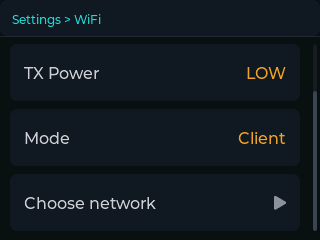

# Settings

[← documentation index](README.md)

A short tap on the circle under the glass opens the settings; the circle takes
you back one level each time, and from the top level it closes them. The line
across the top of the screen is the path you took.

Rows with a **triangle** on the right open a list. Rows with a value on the
right change that value when you touch them, cycling through the options.

```
Settings
├── Clock
│   ├── Bridge          Start Sync · Stop Sync · Drift Comp. · Remember mode
│   └── Sink
│       ├── MIDI
│       │   ├── MIDI USB-C          Enabled
│       │   ├── MIDI DIN Plug       Enabled
│       │   └── Network MIDI 2.0    Enabled · Announce
│       ├── OSC         Enabled · Preset · Host · Port · Custom *
│       └── CV          Enabled · Division · Pulse width · Polarity · Sound
├── WiFi                Status · TX Power · Mode · (mode-dependent)
├── LAN                 Status · DJ Link ID
├── SD card             Store playlist · Track after · Format card
├── UI                  Audio · LED brightness · Screen brightness · Screen flip
└── System              Status · About · Power off · Restart · Factory reset
                        └── Developer      (development builds only)
```

\* The **Custom** row is there only while **Preset** is `CUSTOM`. With
`GENERIC` or `RESOLUME` it would open a list that nothing reads, so it is not
shown at all.

The two networks come first on purpose: nothing works until they are right, and
they are what anybody opening these menus is usually there to check.

---

## Clock

### Clock > Bridge

How the bridge behaves, rather than which direction it runs in — the direction
is the two toggles on the dashboard.

| entry | |
|---|---|
| **Start Sync** | Whether an Ableton transport START is passed on. `OFF` by default, as in Live itself: it has to be asked for. |
| **Stop Sync** | Whether a STOP is passed on. |
| **Drift Comp.** | Online compensation for the difference between our crystal and the players'. Leave it on. |
| **Remember mode** | Whether the state of the two toggles survives a power cycle. |

On **Drift Comp.**: the ESP32's crystal and the players' do not agree, and the
difference is not a constant — the crystal warms up and shifts by roughly
20 ppm over the first five minutes. A stored calibration value is right when
cold and wrong ten minutes later, which is why this is measured continuously
rather than configured. Turning it off is useful for diagnosis and for nothing
else. The detail is in [§4.4 of the protocol notes](protocol-notes.md#44-crystal-drift).

### Clock > Sink

Where the tempo goes. Three families — MIDI, OSC, CV — each with its own page:
[**Clock outputs**](outputs.md).

The three MIDI transports share one clock engine but not their options, so each
gets its own level: the network one has announcement, the DIN a physical port,
USB a device identity.

---

## WiFi

This is the Ableton Link side.

| entry | |
|---|---|
| **Status** | Opens a read-only page. In client mode: network, IP, signal, TX power. In SoftAP mode: IP, connected clients, TX power. |
| **TX Power** | `LOW` / `MID` / `HIGH`. Lower it in a crowded RF environment; raise it if the peers are far. |
| **Mode** | `Client` or `SoftAP`. |

The rows below depend on the mode.



**In Client mode:** **Choose network** scans and lists what it finds; pick one
and type the key. If the key is refused, an **AUTH** badge appears in red on the
dashboard — the network was found, so this is the password and not the signal.

**In SoftAP mode:** **AP name** and **Password**, both editable. The defaults
are `aggeggino` / `m5stack1`, and should be changed if the device ever leaves
your own bench. The device is at `172.16.42.1` and hands out `.100` to `.150`.

The **Status** row carries the network name as a coloured subtitle: green
connected, amber connecting or retrying, red neither.

---

## LAN

This is the DJ Link side, and it is about who we are on the wire rather than
about the bridge.

| entry | |
|---|---|
| **Status** | Read-only: IP address, how it was obtained (DHCP or auto-ip), and the DJ Link ID actually held. |
| **DJ Link ID** | `AUTO` or `OBSERVER`. |

**AUTO** claims a real player number, 1–4, which is what being accepted as
tempo master requires. **OBSERVER** stays on a high number outside the players'
range and never asks for the master role — useful when you only want to watch
the network, or when all four slots are taken.

A number is not simply picked: it is claimed, in stages, because the players
defend theirs. The procedure is in
[§1.8 of the protocol notes](protocol-notes.md#18-master-election-device-number-takeover).

---

## SD card

| entry | |
|---|---|
| **Store playlist** | `ON` / `OFF`. Writes what was played to a CSV on the card. |
| **Track after** | How long a track must play continuously before it counts: 15, 30, 60, 90, 120 or 180 seconds. |
| **Format card** | Erases the card. Two touches. |

**Track after** does two jobs with one number, and that is worth knowing. It is
how long a track must play to be written down, *and* how much silence closes
one playlist file and starts the next. A pause longer than the threshold is read
as the end of a set.

**Format card** is disabled — greyed, no response — while a bridge is running in
either direction, and when no card is in the slot. It takes two touches, and
while it runs the second line of the entry says so. On a card of any size this
takes a while: around two minutes is normal, and the message stays until you
leave the menu.

Details, including the CSV's columns: [**The SD card**](sd-card.md).

---

## UI

| entry | |
|---|---|
| **Audio** | `ON` / `OFF`. The confirmation and error tones. |
| **LED brightness** | `OFF` / `LOW` / `MED` / `HIGH`. `OFF` is a real option, and the right one on a dark stage. |
| **Screen brightness** | `LOW` / `MED` / `HIGH`. |
| **Screen flip** | `ON` / `OFF`. Rotates the display 180°. The two arrows under the glass swap meaning with it — see [the dashboard](dashboard.md#the-three-buttons-under-the-glass). |

---

## System

| entry | |
|---|---|
| **Status** | Read-only: firmware version, MAC, uptime, CPU temperature. |
| **About** | A full-screen intro. Touch it to leave. |
| **Power off** | Two touches. |
| **Restart** | Two touches. |
| **Factory reset** | Erases every setting and restarts. Two touches. |

### The double confirmation

Power off, Restart and Factory reset do not act on the first touch. The row
**arms** itself and shows a red subtitle; only a second touch on the same row
carries it out.

It disarms itself on leaving the screen, on touching any other row, and after
**ten seconds**. That last one matters: an action left armed is worse than no
confirmation at all, because you come back ten minutes later, touch out of
curiosity, and erase everything.

**Factory reset** erases the settings *and* restarts, deliberately as one
action. Leaving the firmware running with its stored settings wiped underneath
it would leave modules using values they read at boot — a half state, which is
worse than either extreme.

### System > Developer

Only in builds with `DJB_DEVELOPER` set. In production the entry does not
exist, and nor does the code behind it.

| entry | |
|---|---|
| **Save screenshots** | `ON` / `OFF`. A long press on the circle writes the screen to the card as a BMP. |

With this on, the long press **no longer locks the screen**: the screenshot
borrows that gesture on purpose, because the two are never wanted at the same
time — screenshots are for documenting at a desk, the lock is for a booth. See
[the dashboard](dashboard.md#the-screen-lock).

---

## Where settings are kept

In NVS, in the ESP32's flash, and they survive a power cycle. `Factory reset`
is what clears them.

One thing with a visible consequence: **a flash write stalls the instruction
cache on both cores** for as long as it takes. Settings that can be changed in
quick succession — the OSC custom messages, the phase offset — therefore do not
write on every tap. The offset is saved 1.5 s after you stop adjusting it; the
custom OSC profile is written when you leave its menu.

The one practical consequence, given that the device is meant to be switched
off without ceremony: a phase offset changed in the last second and a half is
not in flash yet. Give it a moment before cutting the power.
